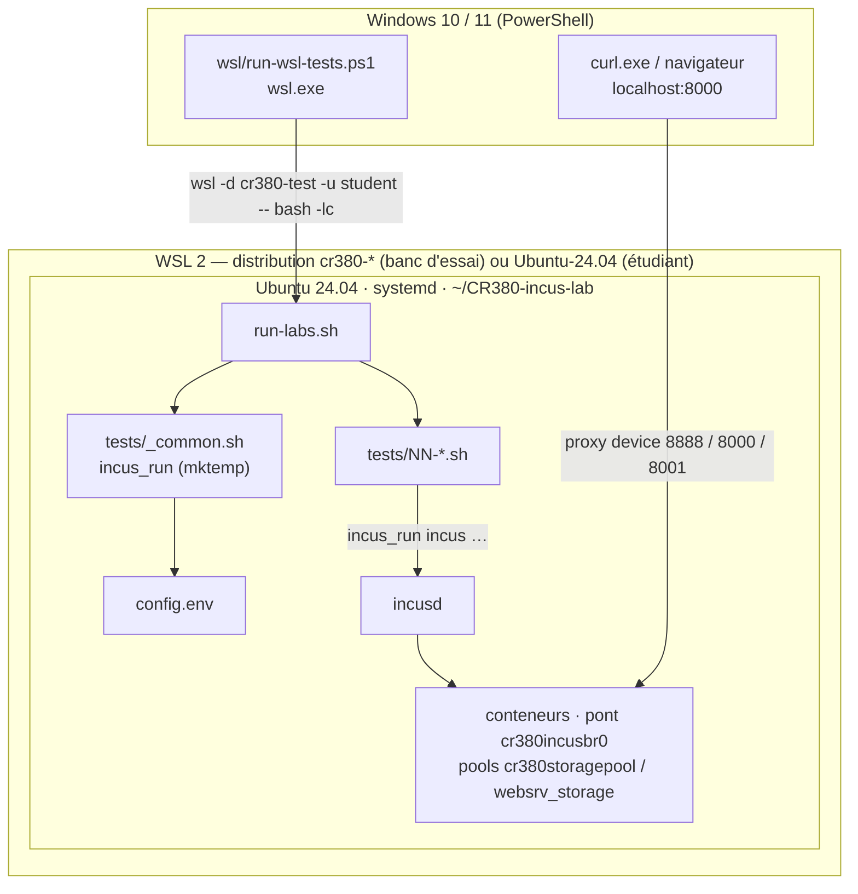
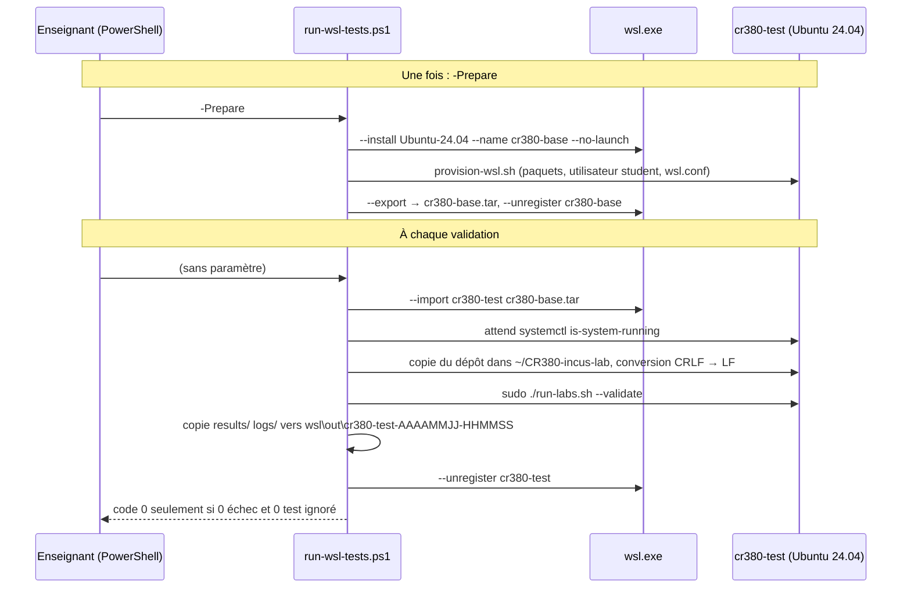

# Architecture / Framework Internals

## Overview

The test suite is a pure Bash framework with no external dependencies beyond standard Linux tools. It's designed for simplicity and readability so that curious students can understand and extend it.

La suite de tests est un framework Bash pur sans dépendances externes au-delà des outils Linux standards.

## Runtime Environment / Environnement d'exécution

The lab runs inside an **Ubuntu 24.04 distribution on WSL 2** (Windows 10 or 11). Incus is a systemd service, so WSL 2 (real Linux kernel) and `systemd=true` in `/etc/wsl.conf` are mandatory. Le lab s'exécute dans une distribution **Ubuntu 24.04 sous WSL 2** ; WSL 2 et systemd sont obligatoires.



Rules enforced by the framework / Règles appliquées par le framework :

| Rule | Where | Why |
|------|-------|-----|
| Repository under `~`, never `/mnt/c` | Lab 00 check | Permissions, CRLF and I/O speed differ on the Windows disk |
| WSL 2 and systemd running | Lab 00 checks | Incus needs a real kernel and a service manager |
| LF line endings | `.gitattributes`, test bench conversion | A `\r` in a `.sh` file breaks Bash (`bash\r`) |
| No Docker alongside Incus (warning) | Lab 00 check | Docker firewall rules can cut container Internet access |
| New group session after `adduser` | Lab 03, `incus_run` (`sg`) | Under WSL: `wsl --terminate <distro>` then reopen Ubuntu |

### WSL Test Bench / Banc d'essai WSL

`wsl/run-wsl-tests.ps1` (Windows side) makes runs deterministic: every run starts from the same reference tarball and ends by deleting the throwaway distribution. It only ever touches distributions matching `^cr380-[a-z0-9-]+$`.



Outputs per run (`wsl\out\<name>-<timestamp>\`): `environnement.txt` (Windows, `wsl --version`, kernel, Ubuntu, Incus), `run.log`, `results\`, `logs\`.

## Key Components

### 1. `_common.sh` — The Engine

All shared logic lives in `tests/_common.sh`. Every test script sources it:

```bash
# Inside each test script:
source "$(dirname "${BASH_SOURCE[0]}")/_common.sh"  # (done by run-labs.sh)
```

Key functions:
- **`pass(msg)`** — Record a passed assertion (green ✓)
- **`fail(msg, expected, actual, hint)`** — Record a failed assertion (red ✗) with diagnostic info
- **`skip(msg, reason)`** — Record a skipped check (yellow ⊘)
- **`run_cmd(description, timeout, cmd...)`** — Execute with timeout, capture output
- **`assert_*`** — Various assertion helpers. `assert_resource_exists` / `assert_resource_not_exists` compare the **exact name** (first CSV column), never a substring
- **`learn_pause(fr, en)`** — In learn mode, display explanation and wait for Enter
- **`check_dependency(num)`** — Skip if a required earlier test failed
- **`wait_for_ready(container)`** — Poll (through `incus_run`) until container is RUNNING
- **`cleanup_container(name)`**, **`cleanup_image(alias)`**, **`cleanup_storage(pool)`**, **`cleanup_volume(pool, vol)`** — Safe, idempotent removal of one lab resource
- **`incus_run(cmd...)`** — Wrapper for incus commands (see below)

#### `incus_run` Wrapper

At source time, `_common.sh` creates an executable wrapper with `mktemp` (`/tmp/.incus_run_cr380.XXXXXX`, removed on exit):
- **Root (EUID=0)**: the wrapper calls `exec "$@"` directly — root accesses the Incus socket without group membership.
- **Regular user**: the wrapper calls `exec sg incus-admin -c "$(printf '%q ' "$@")"` — acquires the `incus-admin` group for socket access, and `%q` keeps each argument intact.

This avoids `newgrp` (which spawns a new shell and breaks scripts) and is compatible with `timeout` (which requires an executable, not a function). All test files use `incus_run incus ...` instead of bare `incus ...`.

#### Container Race Condition Handling

On fast-booting images (e.g., OpenWRT), `incus launch` may auto-start the container before the test's explicit start, resulting in "Error: already running". Tests in Labs 07, 08, 09, and 11 handle this by treating *"already"* in the output as a success condition.

### 2. `run-labs.sh` — The Orchestrator

The master runner:
1. Parses CLI flags
2. Sources `_common.sh` (which sources `config.env`)
3. Handles `--diff` and `--check-images` (no test is run, no report is created)
4. Sources each test file in order
5. Calls `run_test()` from each sourced file
6. Handles dependency-based skipping
7. Generates reports (exit code 1 if at least one test failed)

`--reset NN` calls `reset_lab_artifacts` (containers, images, volume, pool and files of lab NN only) and then reruns lab NN. `--quick` marks labs 00-04 as passed **without running them**: never use it for an official validation (use the full `--validate`).

### 3. `config.env` — Single Source of Truth

All configurable values (image names, container names, timeouts, ports, demo-app repository pinned with `DEMO_APP_REF`) live here. Update this file when image versions change (`./run-labs.sh --check-images` tells which ones disappeared from the registry).

## Execution Flow

```
run-labs.sh
  └─ source _common.sh
       └─ source config.env
  └─ for each test (00, 01, ..., 12, 99):
       └─ source tests/NN-*.sh
       └─ call run_test()
            ├─ section_header()
            ├─ check_dependency() → skip if dependency failed
            ├─ learn_pause() → pause in learn mode
            ├─ run_cmd() + assert_*() → execute and verify
            └─ section_summary() → record result
  └─ finalize_report()
  └─ print_final_summary()
```

## Dependency Graph

```
00-preflight
  └─→ 01-uninstall
       └─→ 02-install
            └─→ 03-post-install
                 └─→ 04-init
                      └─→ 05-registries
                           └─→ 06-images
                                └─→ 07-containers
                                     └─→ 08-port-exposure
                                          └─→ 09-app-container
                                               └─→ 10-file-transfer
                                                    └─→ 11-storage
                                                         └─→ 12-volumes

99-teardown (no dependencies — always runs, cleans up the lab's own resources)
```

If any test fails, all downstream tests are **SKIPPED** (not failed). This prevents cascading failures and makes it clear where the real problem is.

Lab 99 is independent: it always executes regardless of other test results, and removes **only the lab's own** containers, images, volume, storage pool and temporary files (other containers of the student are kept). The base pool `cr380storagepool` and the bridge `cr380incusbr0` created by Lab 04 are left in place.

## Adding a New Test

1. Create `tests/NN-name.sh` with a `run_test()` function
2. Inside `run_test()`:
   - Call `section_header "NN" "Title" "url"`
   - Call `check_dependency "NN-1"` (previous test number)
   - Add your assertions using `assert_*` functions
   - Call `section_summary` at the end
3. Add the test number to the `TESTS` array in `run-labs.sh`

Example:

```bash
run_test() {
    section_header "13" "My New Test" ""
    check_dependency "12" || { section_summary; return 0; }

    assert_success "My check" "hint" some_command --flag
    learn_pause "Explication FR" "Explanation EN"

    section_summary
}
```

## Report Format

JSON reports in `results/`:

```json
{
  "timestamp": "20250101-143000",
  "tests": [
    {"test": "00-Preflight", "status": "pass", "duration_s": 5, "error": ""},
    {"test": "06-Images", "status": "fail", "duration_s": 120, "error": "2 assertion(s) failed"}
  ],
  "summary": {"pass": 35, "fail": 2, "skip": 12}
}
```

## Design Decisions

| Decision | Why |
|----------|-----|
| Pure Bash (no BATS/pytest) | Zero dependencies, students can read it |
| `incus_run` wrapper | Avoids `newgrp` (spawns new shell); works with `timeout`; handles root vs regular user |
| Preseed YAML for init | Reproducible, avoids interactive prompts |
| `config.env` for all values | Single place to update when images change |
| Dual mode (validate/learn) | One tool for both teacher validation and student learning |
| JSON reports | Parseable, diff-able, archivable |
| Sequential dependencies | Real labs build on each other — tests should too |
| Proxy device cleanup before add | Incus proxy device state persists; remove old device first to avoid conflicts |
| WSL 2 + systemd required | Incus needs a real Linux kernel and a service manager; Lab 00 refuses anything else |
| Reference tarball + throwaway `cr380-*` distribution | Identical starting point for every validation; safe for the host (never touches other distributions) |
| Exact-match assertions and `mktemp` wrapper | No false positives from substrings, no fixed `/tmp` path shared between runs |
