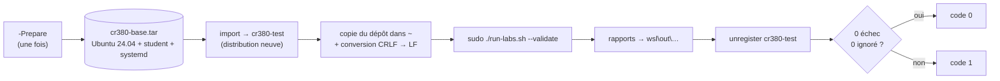

# Guide de l'enseignant / Teacher Guide

## Avant chaque cours / Before Each Class

### 1. Mettre à jour la configuration / Update configuration

Vérifiez que les images sont toujours disponibles dans les registres:

```bash
sudo ./run-labs.sh --check-images
```

Si une image a changé de version, mettez à jour `config.env`:

```bash
vim config.env
# Modifier IMAGE_UBUNTU, IMAGE_ALPINE, etc.
```

### 2. Valider tous les labs / Validate all labs

Exécutez la suite complète dans une distribution WSL neuve (voir « Poste de test WSL » ci-dessous) :

```bash
sudo ./run-labs.sh --validate
```

Résultat attendu: tous les tests passent (🎉 ALL TESTS PASSED).

Si des tests échouent:
- Consultez le log: `logs/test-YYYYMMDD-HHMMSS.log`
- Consultez le rapport: `results/report-YYYYMMDD-HHMMSS.json`
- Comparez avec le run précédent: `sudo ./run-labs.sh --diff`

### 3. Comparer les résultats / Compare results

```bash
sudo ./run-labs.sh --diff
```

Ceci compare le dernier rapport avec le précédent pour détecter les régressions.

## Poste de test WSL / WSL test bench

Les étudiants préparent leur poste avec `gitbook/preparation-hote/README.md`. Pour la validation officielle, utilisez toujours `--validate` complet (jamais `--quick`, qui marque les labs 00 à 04 comme réussis sans les exécuter).



### Valider les labs sur une distribution jetable (PowerShell)

```powershell
# Une seule fois : crée l'état de référence (Ubuntu 24.04, utilisateur student, systemd)
.\wsl\run-wsl-tests.ps1 -Prepare

# À chaque validation : distribution neuve cr380-test, sudo ./run-labs.sh --validate, rapports dans wsl\out\
.\wsl\run-wsl-tests.ps1
```

Le script ne touche qu'aux distributions dont le nom correspond à `^cr380-[a-z0-9-]+$` et
retourne un code non nul au moindre échec ou test ignoré. Ne validez jamais avec `--quick`.
Chaque campagne écrit dans `wsl\out\<nom>-<horodatage>\` : `environnement.txt` (Windows, `wsl --version`,
noyau, Ubuntu, Incus), `run.log`, `results\` et `logs\`. Options : `-Name`, `-RunArgs`, `-Keep`
(conserver la distribution pour diagnostiquer).

Pour comparer deux campagnes, comparez les rapports JSON (`summary` et `tests`) des deux dossiers de `wsl\out\` : la distribution jetable est supprimée à la fin, donc `--diff` n'y voit qu'un seul rapport.

### Personnalisation

- **Git repo URL**: la branche WSL est clonée avec `git clone -b wsl-version <url>`
- **Mot de passe**: chaque étudiant crée son propre utilisateur Ubuntu au premier lancement
- **Versions d'images et dépôt de démonstration** : `config.env` (`IMAGE_*`, `ALIAS_*`, `DEMO_APP_REF`)

## Correction rapide d'un lab / Quick lab fix

Pour réexécuter un seul lab après une correction:

```bash
sudo ./run-labs.sh --reset 09  # Nettoie et réexécute uniquement le lab 09
```

## Structure des rapports JSON / JSON report structure

```json
{
  "timestamp": "20250101-143000",
  "tests": [
    {"test": "00-Preflight", "status": "pass", "duration_s": 5, "error": ""},
    {"test": "01-Uninstall", "status": "pass", "duration_s": 15, "error": ""}
  ],
  "summary": {"pass": 42, "fail": 0, "skip": 0}
}
```

## Calendrier recommandé / Recommended schedule

Utilisation en classe (rythme du cours). `--quick` saute les labs 00 à 04 : à réserver à ce contexte, pas à la validation officielle.

| Semaine | Labs | Commande de validation |
|---------|------|----------------------|
| 1 | 00-04 (Install + Init) | `for i in 00 01 02 03 04; do sudo ./run-labs.sh --lab $i; done` |
| 2 | 05-07 (Images + Conteneurs) | `for i in 05 06 07; do sudo ./run-labs.sh --quick --lab $i; done` |
| 3 | 08-10 (Ports + Apps + Fichiers) | `for i in 08 09 10; do sudo ./run-labs.sh --quick --lab $i; done` |
| 4 | 11-12 (Stockage + Volumes) | `for i in 11 12; do sudo ./run-labs.sh --quick --lab $i; done` |
